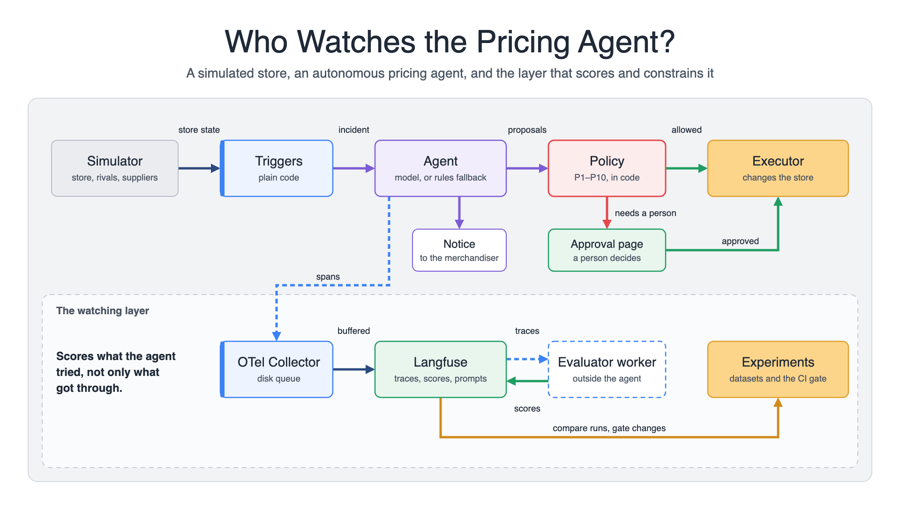

# pricing-watch

An autonomous pricing agent for a **simulated** home-entertainment retailer, and the layer that
watches, scores and constrains it. The store, its customers, competitors and suppliers are all
simulated; no real shop or money is involved

## How it works



## Setup

Python 3.12, [uv](https://docs.astral.sh/uv/) and Docker.

```sh
uv sync
uv run pre-commit install
make langfuse-env     # once: deploy/.env with random secrets and API keys (git-ignored)
make langfuse-up      # Langfuse, its stores, the Collector, the evaluator worker and the app
uv run --env-file deploy/.env pricing-watch langfuse push-prompts --label production
```

Langfuse is at http://localhost:3000 (user `admin@pricing-watch.local`, password
`LANGFUSE_ADMIN_PASSWORD` in `deploy/.env`); the approval page is at http://localhost:8000.

## Running it

```sh
# one scenario, traced to Langfuse; --model gemini or claude for a real model (costs calls)
uv run --env-file deploy/.env pricing-watch sim run --scenario scenarios/unsafe-model.yaml \
    --trace --run-name my-run

# the PR gate: all 13 scenarios in memory with the stand-in model, free, about 70 s
make gate

# an experiment on the Langfuse dataset, gated; compare runs side by side in Langfuse
make dataset
make experiment ARGS="--run-name pr-1 --gate"

# the agent against its rules baseline over several seeds (free, about 10 minutes)
uv run python -m experiments.multi_seed --seeds 1,2,3

# approvals: leave them for a person, then decide on the page
uv run pricing-watch sim run --scenario scenarios/undercut-weekend.yaml --reviewer person \
    --db runs/run.db
```

## Commands

**`pricing-watch` CLI**

| Command | What it does |
| --- | --- |
| `sim run --scenario FILE` | run one scenario; `--model stand-in\|gemini\|claude`, `--seed`, `--trace --run-name NAME`, `--reviewer approve_all\|reject_all\|person`, `--db FILE`, `--prompt-label`, `--content-off` (mask text in traces) |
| `sim compare --scenario FILE` | run a scenario against every baseline on the same seed |
| `approvals list --db FILE` | list proposals waiting for a person |
| `approvals approve ID --db FILE [--note TEXT]` | approve one (also `approvals reject`) |
| `serve --db FILE [--scenario FILE]` | the API and approval page over a run's database |
| `evals worker [--once] [--interval S]` | score finished traces, then keep polling |
| `langfuse push-prompts --label production\|ci` | make the local prompt templates the labelled prompt |
| `langfuse hello` / `heartbeat` | check the pipeline end to end / send one heartbeat |
| `langfuse verify-guardrails` / `verify-spans` | check Langfuse holds exactly what a run sent |

**Experiments** (`uv run python -m experiments.NAME`)

| Command | What it does |
| --- | --- |
| `run [--offline] [--gate] [--model M] [--repeats N] [--prompt-label L]` | run the dataset, score it, optionally gate |
| `sync_dataset` | the same as `make dataset` |
| `compare NOW.json BEFORE.json [--tolerance 0.05]` | fail if any scenario did worse than the last accepted run (outputs from `run --outputs`) |
| `multi_seed --seeds 1,2,3` | the agent against its rules baseline over several seeds |
| `label_queue --runs A,B [--size 50]` | fill the Langfuse queue with notices to label by hand |
| `calibrate [--judge stand-in\|gemini\|claude]` | the judge's agreement with your labels (Cohen's κ) |